# Michel — product ideas (round 7)

*17 November 2026. Phase 1 (experience it) and Phase 2 (propose) of the product round. No code was changed. Pick lots at the end; nothing gets built before that.*

How this was produced:

- **Baseline:** the full CI gate run locally (below).
- **Discord side:** every extension read flow by flow, as a member and as an admin. I looked at the command names and options, what gets typed and what gets picked, what is public or ephemeral, every `send_error` text, embed colours and footers, and tu/vous. Bot behaviour can't be clicked through without a Discord server, so "walking a flow" means following the code path a click takes, with the existing fakes where a claim needed proof.
- **Dashboard:** the real FastAPI app, run against a **fake bot**. The fake has two guilds (one set up, one freshly invited), real channel, role and member objects, and stubs of every loaded extension that keep their `Task`s. The MongoDB 8 behind it is seeded with 60 days of XP events, infractions, audit entries, bot-message slots and task health. Three sessions: developer, guild admin, plain member. Every page and state was screenshotted with Playwright at 1440×900 and 390×844 and reviewed. The harness lives outside the repo (idea [D8](#d8-a-dashboard-demo-mode) proposes keeping it).
- **Every bug claim is confirmed** by a test that fails today or by a browser assertion ([D1](#d1-confirmed-bugs)).

Legend: 🚀 = ambitious. **Effort** (focused work, tests included): S ≤ 1 day · M 2–4 days · L 1–2 weeks · XL more. **Data** = new data the idea stores. New personal data always comes with `/mes-donnees` export + delete, the 30-day purge, the backup (automatic for guild collections) and a `Privacy.md` line, as the Phase 3 rules require.

---

## Contents

1. [Baseline](#baseline)
2. [What I saw](#what-i-saw)
3. [Top 5 picks](#top-5-picks)
4. [A. Make Michel feel alive](#a-make-michel-feel-alive) (A1–A11)
5. [B. Discord UX](#b-discord-ux) (B1–B11)
6. [C. Dashboard](#c-dashboard) (C1–C10)
7. [D. Quality findings](#d-quality-findings) (D1–D8)
8. [Lots](#lots)

---

## Baseline

| Check (as in `ci.yml`) | Result |
|---|---|
| `ruff check .` / `ruff format --check .` | pass (587 files) |
| `mypy src features extensions` | pass (376 files; 64 extension modules still skipped, see [D4](#d4-mypy-the-last-64-modules)) |
| `pytest --cov` against MongoDB 8 (CI's pinned digest) | **2 138 passed**, 6 skipped (the browser ones), 58 s |
| `pytest -m browser` (Chromium) | 6 passed |
| Coverage: total / `src`+`features` | 67.74 % (floor 65) / 85 % (floor 81) |
| `uv lock --check` | pass |
| `config.example.json` drift + `check_config.py` | no drift, OK |
| `pip-audit` on runtime pins | no known vulnerabilities |
| detect-secrets sweep, hygiene hooks | clean |

Local notes: Python 3.13 here (CI runs 3.15 and 3.12). Docker Hub was rate-limited, so the same `mongo:8@sha256:05b3…` came from `mirror.gcr.io`.

---

## What I saw

### Discord side

- **Too many commands, in two languages.** A server with every module on gets about **65 top-level commands**. The names mix English (`/rank`, `/leaderboard`, `/suggest`, `/poll`, `/giveaway start prize:`, `/rolemenu create entries:`) and French (`/anniversaire`, `/bilan`, `/mes-donnees`, `/rappelvote`). Separators mix too (`/zevent_finish`, `/poll-anonyme`). Tricount alone adds 9 top-level commands.
- **Everything is typed.** Across 39 extensions there are **0 select menus and 0 context menus**, and modals only in Confrérie. `/rolemenu create` wants `roleId,emoji,libellé;…`. Poll options are one `;`-separated string. A reminder takes hour and minute as two integers plus a `JJ/MM/AAAA` date. `/anniversaire` makes the timezone mandatory on a French bot. Staff decide suggestions with `/suggestion approve id:12`.
- **Discoverability.** `/aide` is a flat, paginated list of every command, with no word on what a module does. Michel says nothing when it joins a server.
- **When something fails.** Unexpected errors are handled well: an ephemeral reply carries a reference that matches the logs (`src/discord_ext/errors.py`). Many refusals don't say what to do next, though. "Vous ne pouvez pas utiliser cette commande dans ce salon." doesn't name the right channel. "Réservé au staff." doesn't name the role. `/suggestion approve` is offered to every member and then refused.
- **Public or ephemeral.** Mostly sensible: confirmations are ephemeral, lists and leaderboards public. Some exceptions: `/rank @x` pings x when they have no XP yet (D1). Poll footers print the author's user ID publicly. Level-up messages always land in the channel where the member typed.
- **Tone.** Counting tu/vous forms in user-facing strings: 8 modules speak *tu* only, 4 *vous* only, and 6 mix both in the same module (secretsanta, tricount, giveaway, spotify, reminders, compareai: "Tu n'as aucun rappel" next to "Utilisez JJ/MM/AAAA").
- **Embed style.** The palette has 19 constants, including pure `#00FF00` / `#FF0000` (harsh on Discord's dark theme), plus raw `0x59AF37`, `0xDBEA2B`, `MaterialColors`, `BrandColors` outside it. Success-green is used for neutral lists (birthdays, the leaderboard). Footers vary ("Créé par x (ID: …)", "Source: VLR.gg", none).
- **Proactivity.** Each module talks about its own events (level up, birthday, star, live). Nothing ties the modules together, and the bot never sums up what happened.

### Dashboard

The dark theme is clean and coherent. The XP stats page is excellent. Hash routes, the dirty badge, the session-expired banner and keyboard focus (a 2 px outline) all work. The problems are mostly about **IDs, guidance and previews**:

| | |
|---|---|
| 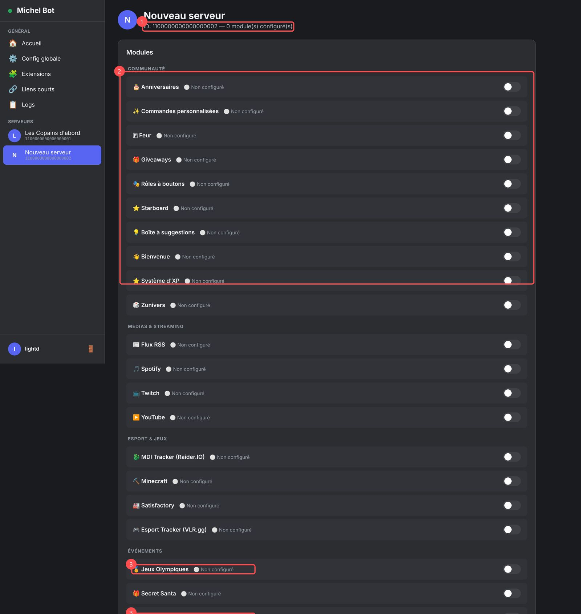 | **A freshly invited server** (1) shows only "0 module(s) configuré(s)" and its raw ID, then (2) 31 identical "Non configuré" switches in six categories, with no description, no starting point and no recommendation. (3) Dead events are still offered: Jeux Olympiques (Milan-Cortina 2026, over since February) and Speedons (2025). |
| 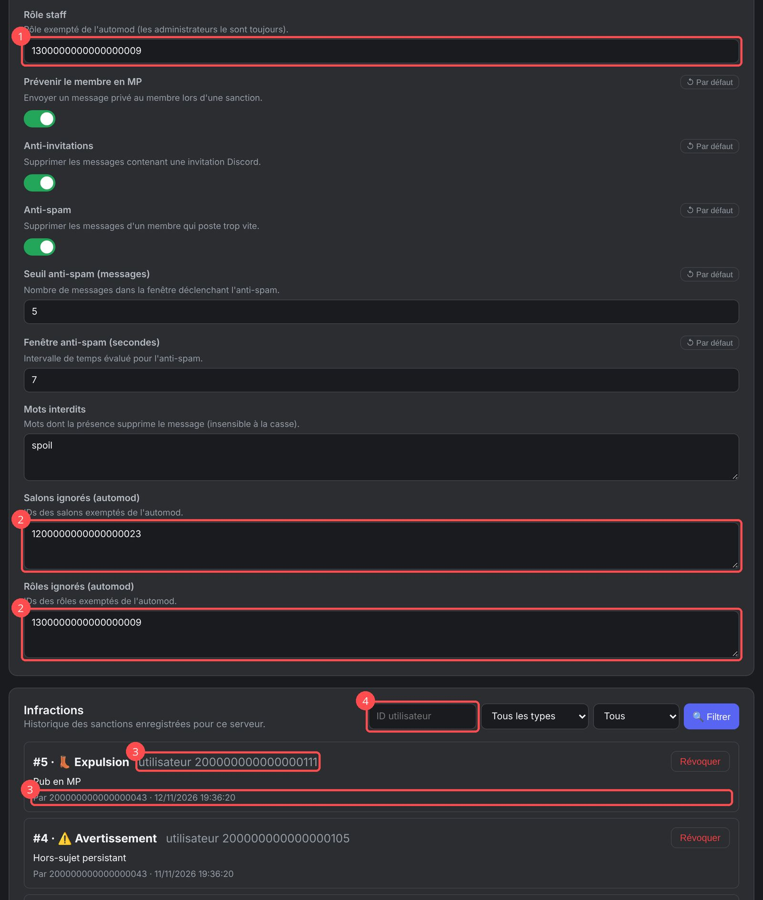 | **IDs everywhere.** (1) The staff role is typed as a raw ID: `role` fields render as a plain text input, although `GET /api/servers/{id}/roles` exists. (2) Ignored channels and roles are textareas of IDs. (3) The infraction list shows "utilisateur 2000000000…" and "Par 2000000000…": a moderator can't tell who was sanctioned. (4) The filter asks for a typed user ID. |
| 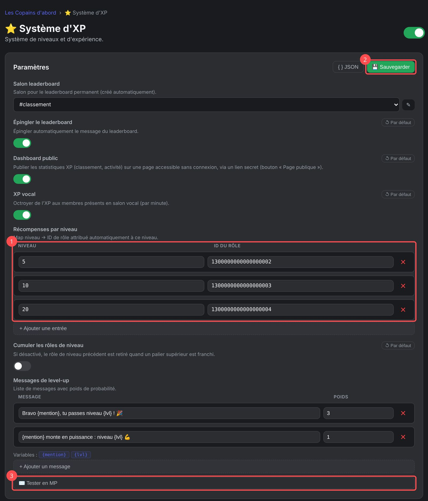 | (1) Level rewards are mapped to role IDs. (2) "Sauvegarder" sits in the card header and scrolls out of view on a 3 400 px page. (3) "Tester en MP" is the only way to see a template rendered. |
| 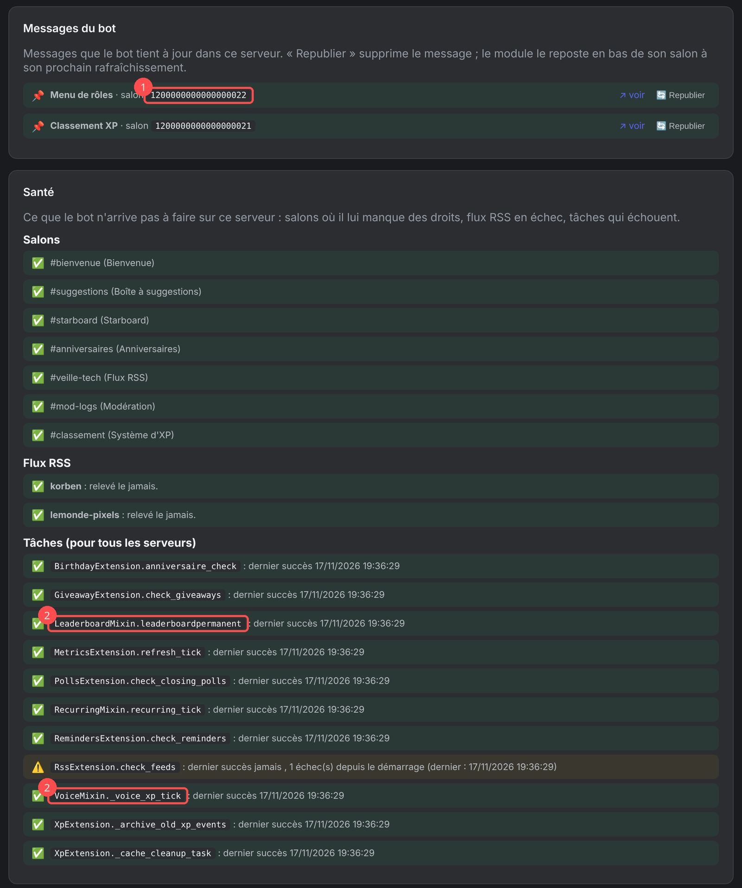 | (1) "Messages du bot" shows `salon 1200000000000000022` rather than `#rôles`. (2) The health card shows guild admins internal names such as `LeaderboardMixin.leaderboardpermanent` and `VoiceMixin._voice_xp_tick`. |
| 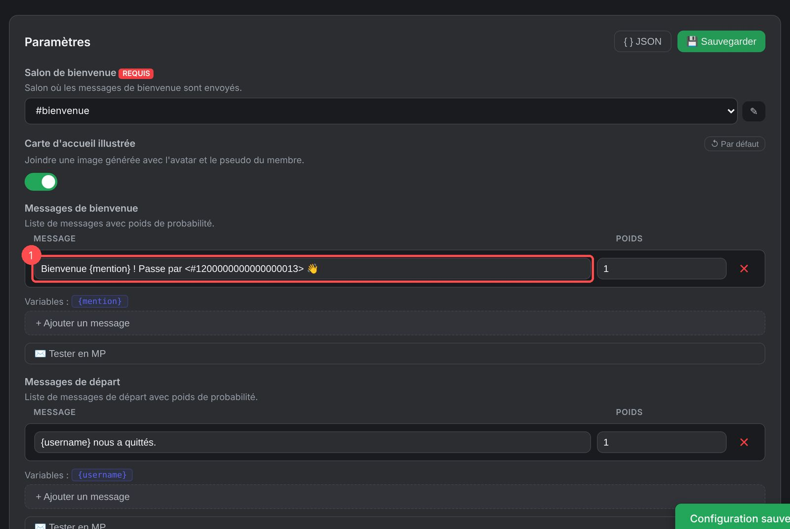 | Templates are raw text. (1) `<#1200000000000000013>` is what the admin sees, with no preview of the message, card or mentions. |
| 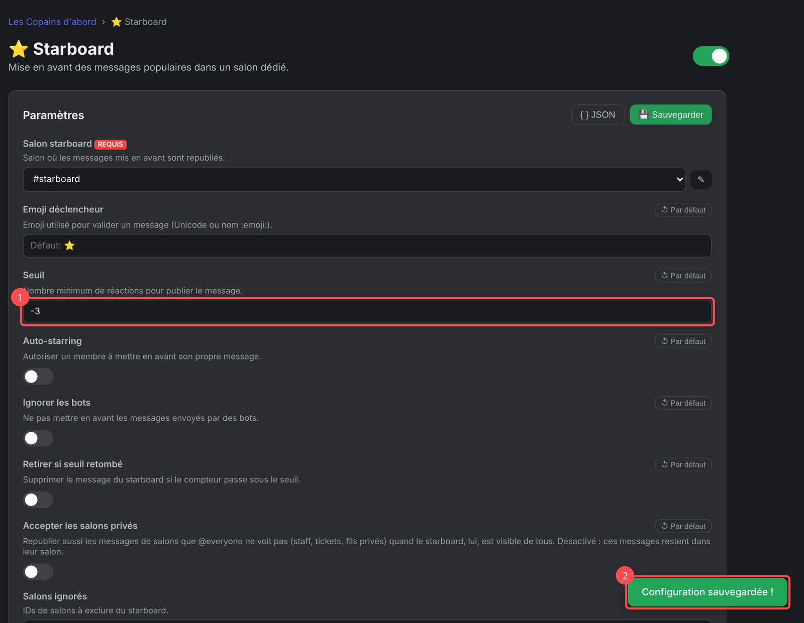 | (1) A starboard threshold of **−3** (2) is saved with "Configuration sauvegardée !". 14 numeric fields have no bounds (D1, D2). |
| 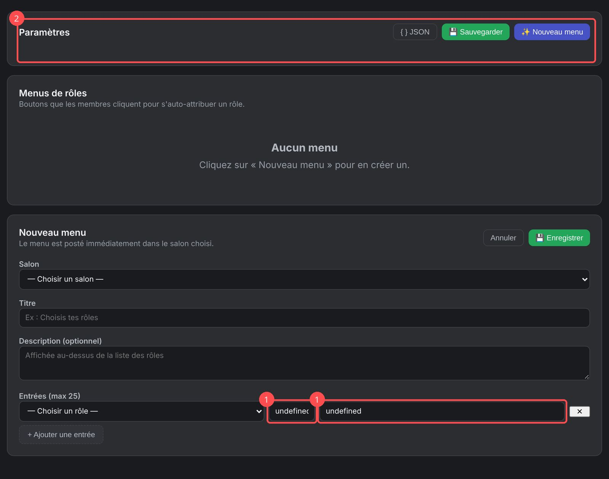 | (1) A new role menu's first row is pre-filled with the text `undefined`, twice (D1). (2) This module's page shows an empty "Paramètres" card with Save and JSON buttons. |
| 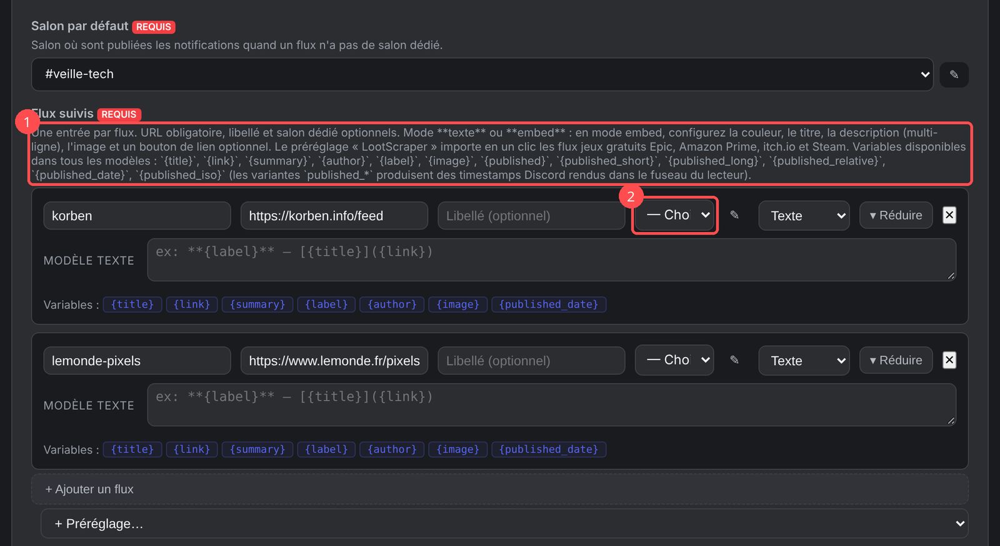 | (1) Field help renders Markdown literally (`**texte**`, backticks). (2) The per-feed channel picker is truncated to "— Choi". |
| 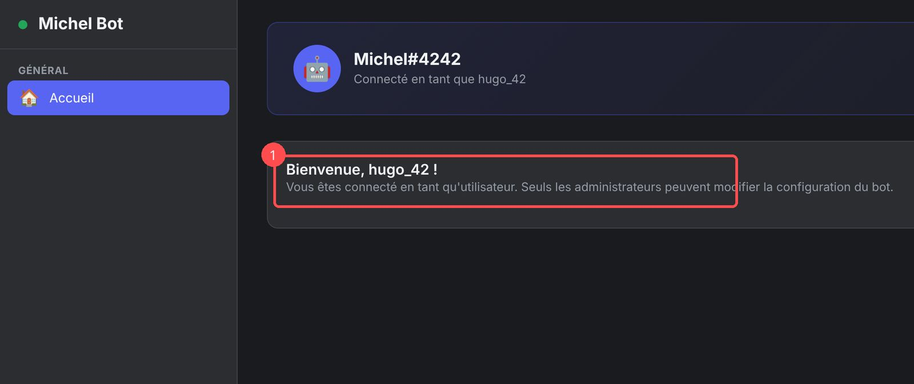 | **A plain member** can log in and lands on a dead end: (1) "Seuls les administrateurs peuvent modifier la configuration du bot." |
| 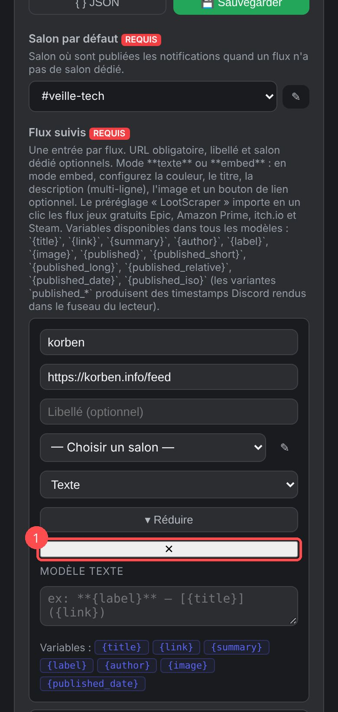 | **Phone.** Layouts reflow well overall, but (1) the RSS row's ✕ becomes a full-width white bar. The server page is 5 000 px tall on a phone and global config 8 600 px, with no in-page navigation. |

Also measured:

- **Contrast** (WCAG AA needs 4.5:1 for this text size): white on the green "Sauvegarder" button **3.18:1**, white on red **3.77:1**, the `#5865f2` breadcrumb link on the page background **3.74:1**, the unstyled "config globale" link on the Liens courts page **1.83:1**.
- **Confirmations:** toggles use the browser's native `confirm()`, unlike the themed modal (with focus trap) used elsewhere.
- **Developer pages:** the Extensions page lists file names (`birthday.py`, `random_.py`) with no description. Global config is one 6 000 px column of 24 sections with no search. "Nettoyer la config", a destructive action, is a red primary button next to "Exporter".

---

## Top 5 picks

1. **Fix lot first ([D1](#d1-confirmed-bugs) + [D2](#d2-bounds-on-every-number-and-a-guard)).** One typo can wipe a server. An admin who types `1` (or any negative number) in "Seuil anti-spam" makes automod delete *every* non-staff message, record a case for it and DM the author, and the dashboard accepts the value. Moderators also can't see `/delete`. Small, fully tested, no design question.
2. **[A6 Secret Santa 2.0](#a6-secret-santa-20).** It's mid-November. Wish lists, anonymous Santa↔recipient messages and "cadeau envoyé" are what turns the current join-and-draw into the event of the month. It stays inside one extension. To be useful for December 1 draws it must ship by about November 28.
3. **[C3 No more IDs in the dashboard](#c3-no-more-ids).** Every admin page shows or asks for raw IDs, and moderators can't read their own infraction list. The endpoints already exist (`/roles`, `/channels`, `/members?ids=`), so this is the biggest perceived-quality gain per hour.
4. **[A1 The Sunday paper (La Gazette)](#a1--la-gazette-du-dimanche-the-sunday-paper).** One weekly post that weaves XP, starboard, birthdays, new members, the playlist and suggestions together. It turns seven separate modules into one community voice, and stores no new personal data.
5. **[B1 Right-click actions](#b1-context-menus) with [A7 Report to moderators](#a7-report-a-message-to-the-moderators).** Discoverability with nothing to type ("⏰ Me le rappeler" on any message), and it closes a real moderation gap: members have no private way to flag a message.

Runners-up: [C1 guided first setup](#c1--guided-first-setup) (the empty-server experience is the weakest moment of the product) and [B8 one visual identity](#b8-one-visual-identity-and-one-voice).

---

## A. Make Michel feel alive

### A1 🚀 La Gazette du dimanche (the Sunday paper)

- **Problem.** Michel only reacts, one module at a time. Nothing tells a community what happened this week, and the modules never mention each other.
- **For.** Members (read it), admins (switch it on, pick a day and channel).
- **Sketch.** A weekly post. Each section appears only if its module is on and something happened:
  - most active members (from `xp_events` of the week);
  - the most-starred message (starboard entries of the week);
  - birthdays in the next 7 days (day and month only, honouring `hideyear`);
  - new members (Discord's `joined_at`);
  - playlist additions and the most-voted track;
  - suggestions decided;
  - giveaway winners.

  An optional intro paragraph is written by the AI module, counts against its quota and is off by default. `/gazette` shows the latest edition (ephemeral), and the dashboard has a preview with "Publier maintenant".

  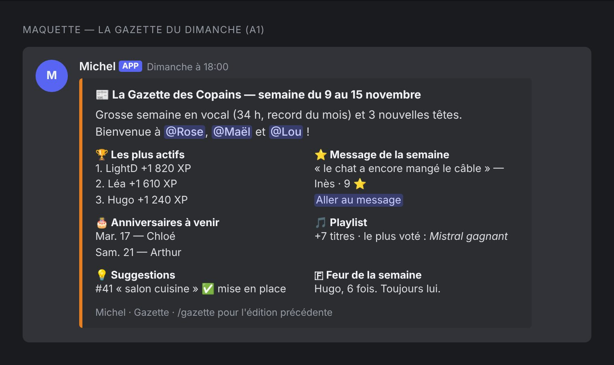
- **Effort.** L. **Risk.** Low–medium: the aggregations stay bounded (one week, top N), and the mentions in the post must not ping (`NO_PINGS`).
- **Data.** No new personal data: it reads what modules already keep. It adds a `bot_messages` slot and the date of the last edition. Feur counters carry no timestamps, so a "feur of the week" would need per-event storage; it's left out of v1.

### A2 `/profil`, a member's card

- **Problem.** A member's footprint is scattered across `/rank`, `/feurstats`, `/anniversaire liste`, Spotify credits and starboard mirrors.
- **For.** Members.
- **Sketch.** `/profil [membre]`, plus a user context menu "📊 Profil" (B1). It renders a Pillow card that extends the rank card: level, rank, XP this season (A4), stars received, tracks added, suggestions accepted, giveaways won, birthday (day and month, only if the year isn't hidden) and badges (A3). Every line comes from data the server already shows publicly.
- **Effort.** M. **Risk.** Low. **Data.** None.

### A3 🚀 Achievements (succès)

- **Problem.** Long-time members have nothing to show, and quieter features (voice, playlist, suggestions) never get noticed.
- **For.** Members.
- **Sketch.** Badges unlocked by events across modules:

  ```
  ⭐ Étoilé·e            — un message au starboard
  🎙️ Pilier du vocal     — 10 h de vocal (XP voix)
  🎵 DJ                  — 10 titres ajoutés à la playlist
  💡 Boîte à idées       — une suggestion mise en place
  🎂 Vieille branche     — 1 an sur le serveur
  🇫 Feur ×100           — on ne présente plus
  ```

  A subtle announcement (a reaction on the triggering message, or the level-up channel from B10). The badges show on `/profil`, the public page and the member space (C6). Admins can switch individual badges off.
- **Effort.** L. **Risk.** Medium: unlock checks must hook into existing listeners without slowing them; announcements must not spam.
- **Data.** `achievements` per guild (`user_id`, `badge`, `earned_at`), personal. Deleted with the member through `/mes-donnees` and the 30-day purge, backed up with the guild database, plus a line in `Privacy.md`.

### A4 XP seasons

- **Problem.** The all-time leaderboard ossifies. On a server that's three years old, a newcomer will never see the top 10, so it stops motivating anyone.
- **For.** Members, admins.
- **Sketch.** A season is a month or a quarter (configurable). `/leaderboard` defaults to the current season, with an all-time tab. At season end Michel posts a podium, and an optional "Champion·ne du mois" role (`role_use="grant"`) moves to the winner. It's computed from `xp_events`, which are already timestamped and kept 400 days, so no new counters. The public XP page gets a season tab.
- **Effort.** M. **Risk.** Low.
- **Data.** `xp_seasons` (the top 10 IDs per finished season), personal: anonymised on deletion (`NOBODY`, like shared records today) and listed in `Privacy.md`.

### A5 Shared agenda

- **Problem.** What's coming up is spread over Discord events, birthday wishes, giveaway end dates, poll deadlines, the Secret Santa date and Twitch plannings.
- **For.** Members.
- **Sketch.** `/agenda` lists the next 14 days: scheduled events (including the ones Twitch and Zevent manage), birthdays, giveaways closing, polls closing, Secret Santa draw and exchange. An optional pinned message refreshes itself (a `GuildMessages` slot), and the server page gets a calendar view. Personal reminders are never listed.
- **Effort.** M. **Risk.** Low. **Data.** None.

### A6 Secret Santa 2.0

- **Problem.** Today: a join button, a draw and a DM with a name. Everything else happens outside Discord or breaks the secret: what to buy, asking a question, knowing the gift was sent.
- **For.** Members, the organiser.
- **Sketch.**
  1. Joining opens a modal "Ta liste d'envies" (optional, editable until the draw through "📝 Ma liste").
  2. The draw DM includes the recipient's list, the budget and the date.
  3. "✉️ Écrire anonymement" opens a modal; Michel DMs the recipient "💌 Message de ton Père Noël secret" with "↩️ Répondre", which relays the answer back. Rate-limited, length-capped, sent with `NO_PINGS`, and with a "🚩 Signaler" that goes to the organiser.
  4. "📦 Cadeau envoyé" and "🎁 Bien reçu" statuses. The organiser sees counts only in `/secretsanta participants`.
  5. A reminder DM 3 days before the date goes to Santas who haven't marked theirs sent.
  6. The module page shows the session: participants, statuses, and draw / reveal buttons.

  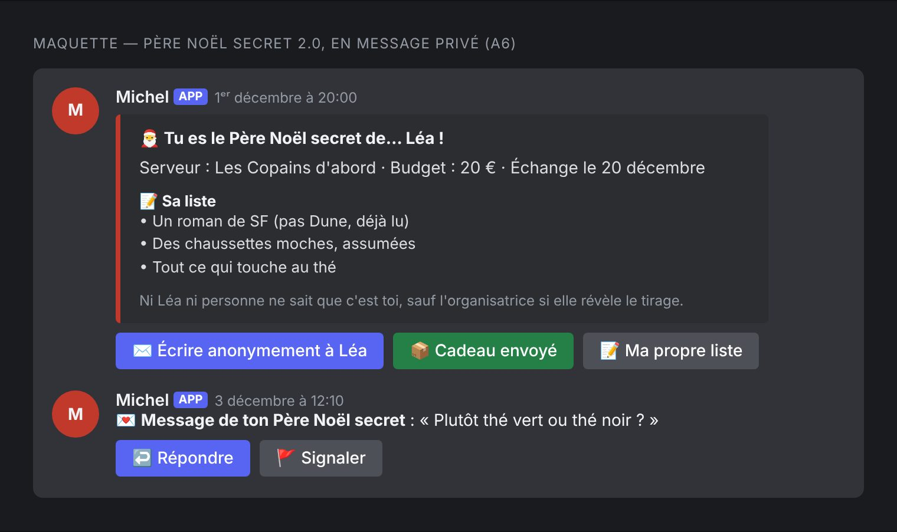
- **Effort.** M. **Risk.** Medium: the relay could be abused (hence rate limits, report, and no stored contents), and closed DMs need a fallback (an ephemeral notice telling them to open their DMs).
- **Data.** Wish list text and gift-status flags per participant (personal), plus relay counters (no message content is kept). Covered by export and delete, the purge and `Privacy.md`: kept until the session closes plus 30 days.

### A7 Report a message to the moderators

- **Problem.** A member who sees something bad must ping a moderator publicly or DM someone. Moderators have no queue. The moderation module can sanction but has no intake.
- **For.** Members, moderators.
- **Sketch.** A message context menu "🚩 Signaler aux modérateurs" opens a modal for the reason. The reporter gets an ephemeral "Merci, c'est transmis". In the mod-log channel a card appears with the quoted message (clipped), a jump link, the reporter (visible to moderators only) and buttons 🗑️ Supprimer · ⚠️ Avertir · 🔇 Exclure 10 min · ✅ Classer. Each button acts with the clicker's rights (`can_moderate`, `author_can`), records the infraction and edits the card with who handled it. A message reported twice raises a counter on the same card. Optionally: "Ton signalement a été traité."
- **Effort.** M. **Risk.** Medium: abuse (a cooldown per reporter) and quoted content (clipped, no pings).
- **Data.** `reports`: message, reported author, reporter, reason, status, handler. Personal. Kept as a moderation record like infractions, with the reporter's ID anonymised on `/mes-donnees supprimer`. In `Privacy.md` next to moderation.

### A8 Welcome 2.0

- **Problem.** The welcome message only knows `{mention}` (and `{username}` on leave). There are no buttons, no arrival role, and nothing for the rest of the server to do.
- **For.** New members, admins.
- **Sketch.** More variables (`{serveur}`, `{nombre}`, `{pseudo}`) and up to three buttons: a link to #règles, a jump to a role menu, `/aide`. An arrival role (`role_use="grant"`). A "👋 Souhaiter la bienvenue" button for existing members: each click adds a name ("3 personnes te souhaitent la bienvenue"), a cheap and warm engagement loop. Optionally, a DM copy. (Shown in the C4 mockup.)
- **Effort.** M. **Risk.** Low.
- **Data.** The greeters of each welcome message: member IDs, kept 7 days, then the message is frozen. Listed in `Privacy.md`.

### A9 Custom commands 2.0

- **Problem.** Custom commands can only pick a random text or GIF, so the classic community command (`/calin @Léa`) can't be built.
- **For.** Admins, members.
- **Sketch.** An optional "cible" member option; variables `{auteur}`, `{cible}`, `{serveur}`; a GIF shown as an embed image instead of a bare link; a per-command cooldown; allowed roles.

  ```
  /calin cible:@Léa  →  Hugo fait un gros câlin à Léa 🤗  [GIF]
  ```
- **Effort.** S–M. **Risk.** Low. **Data.** None.

### A10 Live notifications that ping

- **Problem.** A Twitch live notification is an embed with no mention and no custom text (`extensions/twitch/notifications.py`), so the members who want to know aren't notified.
- **For.** Members, streamers, admins.
- **Sketch.** Per streamer: a role to mention (`role_use="mention"`) and a message template (`{streamer}`, `{titre}`, `{jeu}`, `{lien}`). The notification carries a "🔔 M'avertir des lives" toggle that self-assigns the role, under the same grant rules as role menus. The same for YouTube channels.
- **Effort.** M. **Risk.** Low. **Data.** None.

### A11 🚀 Catch-up (`/rattrapage`)

- **Problem.** Coming back to a busy channel means scrolling through 300 messages.
- **For.** Members.
- **Sketch.** `/rattrapage` returns an ephemeral AI summary of the messages since your last one (at most 200), with jump links to the key moments. It reuses the AI module, its kill switch and daily quotas, and only works where the module is on and the admins enabled it for that channel. Channel history goes to the provider, exactly as `/ask` history does today.
- **Effort.** M. **Risk.** Medium: cost and privacy, both kept under the existing guards, opt-in per channel. **Data.** None stored (usage counters exist).

---

## B. Discord UX

### B1 Context menus

- **Problem.** Michel has no context menus. Every action means remembering a command name and copying IDs or text.
- **For.** Everyone.
- **Sketch.** Discord allows 5 message and 5 user context menus per scope; this uses 4 and 3.
  - On a message: **⏰ Me le rappeler** (a modal with "quand ?" and a note; the reminder DM links back to the message), **🚩 Signaler** (A7), **💡 En faire une suggestion**, **⭐ Mettre au starboard** (staff).
  - On a member: **📊 Profil** (A2), **🛡️ Historique** (moderators, ephemeral list of infractions), **⚠️ Avertir…** (moderators, a modal for the reason).

  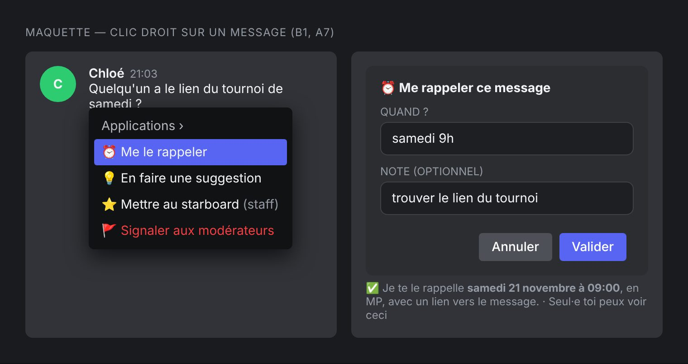
- **Effort.** M. **Risk.** Low. **Data.** Reminders gain a jump link (same data, new field).

### B2 Forms and natural dates instead of typed options

- **Problem.** Long texts in one-line options, values glued together with `;`, hour and minute as separate integers.
- **For.** Members, admins.
- **Sketch.**
  - `/suggest` opens a modal (title plus a paragraph) instead of a 1 500-character option.
  - `/sondage` (B4) opens a modal with the question and one option per line.
  - `/giveaway start` opens a modal (prize, description, duration, winners).
  - `/rappel quand:"samedi 9h"` accepts "dans 2h", "demain 18h30" or "12/12 9h". A pure French date parser goes in `features/reminders`, and its autocomplete echoes the reading back ("→ samedi 21 nov. 09:00").
  - `/anniversaire`: the timezone becomes optional (default Europe/Paris), and "12/03" is accepted without a year.
- **Effort.** M. **Risk.** Low (the parser is pure and table-tested). **Data.** None.

### B3 Pick, don't type

- **Problem.** `/rolemenu create entries:"1234567890,🎮,Gamers;…"`, `/reminder remove` with up to 25 buttons, giveaways open to everyone.
- **For.** Admins, members.
- **Sketch.**
  - `/rolemenu create` asks for a channel and a title, then shows an ephemeral `RoleSelectMenu` (up to 25 roles), a preview, then "Publier".
  - Role menus get a dropdown style next to buttons: min and max picks, and "one role of the group" for colour roles.
  - `/reminder remove` uses a `StringSelectMenu`.
  - `/giveaway start` gains an optional required role and a minimum XP level, which connects the giveaway and XP modules.
- **Effort.** M. **Risk.** Low–medium: the role-grant rules apply as today. **Data.** None.

### B4 One `/sondage`

- **Problem.** Four commands (`/poll`, `/poll-anonyme`, `/poll-classement`, `/editpoll`) with `;`-separated options. The footer prints the author's ID. `/poll` declares user-install on a guild-scoped command, which Discord ignores (D6).
- **For.** Members.
- **Sketch.** `/sondage mode:[public|anonyme|classement]` followed by the B2 modal. Public polls become **native Discord polls**: interactions.py 5.16 ships `Poll`, and Discord then handles votes, results, closing and accessibility. Anonymous and ranked polls keep their buttons. "Modifier" becomes a button visible to the author.
- **Effort.** M. **Risk.** Low–medium: native polls last 1 hour to 32 days. **Data.** None (less, in fact).

### B5 Suggestions with staff buttons and a thread

- **Problem.** Staff must type `/suggestion approve id:12 motif:…`, the author is never told, and the discussion happens elsewhere.
- **For.** Members, staff.
- **Sketch.** The suggestion message gets ✅ Approuver / ❌ Refuser / 🛠️ Implémentée buttons. They're visible to everyone but checked against the staff role, and each opens a modal for the reason. A "Discussion #42" thread is created automatically. The author gets a DM on the decision. The `/suggestion` commands get autocomplete over open suggestions and are hidden from members (`default_member_permissions`).
- **Effort.** S–M. **Risk.** Low. **Data.** A thread ID per suggestion.

### B6 French command names, fewer commands

- **Problem.** About 65 top-level commands, English and French mixed (above), option names in English (`prize`, `title`, `entries`, `channel`, `song`, `hideyear`).
- **For.** Members.
- **Sketch.** Since there is one deployment, rename to French with hyphens everywhere (or add `fr` `name_localizations` if English muscle memory matters): `/niveau`, `/classement`, `/suggerer`, `/sondage`, `/concours lancer lot:`. Group Tricount under `/tricount …` (9 commands become 1) and Spotify under `/musique …`. A registry test fails on a guild command or option without a French name.
- **Effort.** M. **Risk.** Low: the habit change is announced in the Gazette. **Data.** None.

### B7 `/aide` 2.0 and a hello when Michel joins

- **Problem.** `/aide` lists commands but never explains a module. When the bot joins a server, nothing happens.
- **For.** Members, admins.
- **Sketch.** `/aide` opens on a module picker (`StringSelectMenu`). Each page says what the module is for, the three commands to know and what happens automatically ("Michel donne de l'XP à chaque message, une fois par minute"). The text comes from one new `__help__` on each schema, which the dashboard catalog (C2) reuses. On `GuildJoin`, Michel posts once in the system channel: what it is, a dashboard link, `/aide`.
- **Effort.** S–M. **Risk.** Low. **Data.** None.

### B8 One visual identity and one voice

- **Problem.** The palette has 19 colours including pure RGB primaries, there are raw colours outside it, success-green is used for neutral content, footers are inconsistent, and tu/vous varies by module (counts in [What I saw](#what-i-saw)).
- **For.** Everyone.
- **Sketch.** `src/discord_ext/look.py` provides `card(module, kind="info|success|warning|error|neutral", …)`. It builds the embed with a module accent colour from a softened palette (checked for contrast on Discord's dark and light themes), the module's icon and label as the author line, and a "Michel · {module}" footer. Reply helpers `ok()`, `oops()` and `ask()` standardise the prefixes. A one-page `docs/VOIX.md` sets the voice: *tu* everywhere, short sentences, say what to do next. A guard test fails on `color=0x…` or `MaterialColors` outside `look.py`. Modules migrate one at a time.
- **Effort.** M–L (mostly mechanical). **Risk.** Low. **Data.** None.

### B9 Errors that tell you what to do

- **Problem.** Refusals that don't help.
- **For.** Members.
- **Sketch.**

  ```
  avant : ❌ Vous ne pouvez pas utiliser cette commande dans ce salon.
  après : 🎵 /addsong se lance dans #musique.

  avant : ❌ Réservé au staff.
  après : 🔒 Seul le rôle @Modérateur peut trancher une suggestion.

  avant : ❌ Format de date invalide. Utilisez JJ/MM/AAAA
  après : 📅 Je n'ai pas compris « 31/02 ». Exemple : 24/12/2026.
  ```

  Plus, staff-only commands are hidden from members with `default_member_permissions`, with the runtime check kept.
- **Effort.** S. **Risk.** Low. **Data.** None.

### B10 Level-ups: where and when

- **Problem.** Level-up messages always land in the channel where the member typed, interrupting conversations.
- **For.** Admins, members.
- **Sketch.** A destination setting (same channel, a dedicated channel, a DM, or silent) and "announce every N levels".
- **Effort.** S. **Risk.** Low. **Data.** None.

### B11 🚀 Components V2 cards

- **Problem.** Persistent status messages (leaderboard, Zevent, Streamlabs, servers) are dense embeds, with buttons stuck at the bottom.
- **For.** Members.
- **Sketch.** interactions.py 5.16 ships `ContainerComponent`, `SectionComponent`, `TextDisplayComponent` and `MediaGalleryComponent`. Persistent cards become containers with an accent stripe, sections with a thumbnail and an inline button ("Voir mon rang" next to the podium), and separators. This is stage 2 of B8.
- **Effort.** L. **Risk.** Medium: `edit_message_if_changed` must learn to diff V2 payloads, the `IS_COMPONENTS_V2` flag forbids `content` and `embeds`, and the library support is young. **Data.** None.

---

## C. Dashboard

### C1 🚀 Guided first setup

- **Problem.** The weakest moment of the product (screenshot above): a new server faces 31 identical switches, including events from 2025 and February 2026.
- **For.** Server admins.
- **Sketch.** A short wizard:
  1. Pick a "pack": *Entre potes*, *Communauté de stream*, *Équipe / esport* or *Sur mesure*. A pack is a preset of module configs, saved through the normal validated save path.
  2. Choose channels and roles with pickers.
  3. Test the welcome message in a DM.
  4. Optionally announce Michel.

  The server page then keeps a "Pour bien démarrer" checklist until it's done, computed from facts (permissions OK, welcome channel set, moderator role set).

  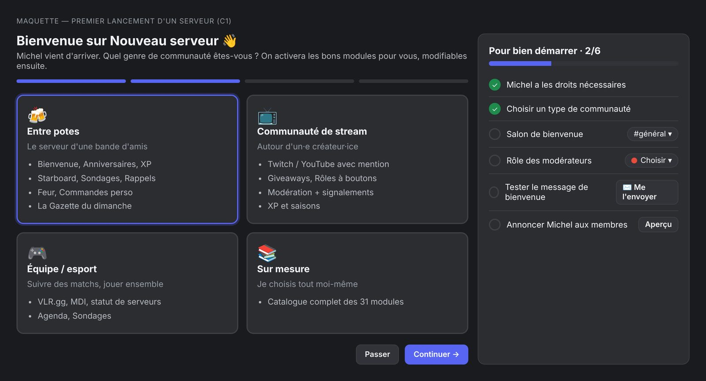
- **Effort.** L. **Risk.** Low–medium: presets go through the same role and channel checks and never overwrite a configured module. **Data.** A "checklist dismissed" flag in `servers.<id>`.

### C2 A server page that leads with the server

- **Problem.** The server page is a flat 31-row switch list, followed by developer-flavoured cards.
- **For.** Admins.
- **Sketch.** An overview at the top: active members over 7 days and messages (from the XP data), a health summary ("2 problèmes"), recent changes (audit). Below it, modules as a grid of cards (icon, one-line `__description__`, state, last activity) with a search and filters for Actifs / Disponibles / Archivés (D7). The health card speaks human: "Classement XP (toutes les heures) ✓" rather than `LeaderboardMixin.leaderboardpermanent`.
- **Effort.** M. **Risk.** Low. **Data.** None.

### C3 No more IDs

- **Problem.** See the moderation, XP and server screenshots. In numbers: 6 `role` fields are text inputs, 2 `keyvaluemap`s map to role IDs (`levelRewards`, `lldapRoleGroups`), 4 `list` fields hold channel or role IDs, infractions show user IDs, and bot-message slots show channel IDs.
- **For.** Admins, moderators.
- **Sketch.**
  - A role picker (from `GET /api/servers/{id}/roles`) with coloured chips and warnings ("au-dessus de Michel").
  - New schema types `channellist` and `rolelist` with multi-pickers, replacing `list` where the items are IDs.
  - A role picker for `keyvaluemap` values when `role_use` is set.
  - Infractions resolved to names (`/members?ids=`), filtered through the member search, with a click opening the member's history.
  - Channel names in "Messages du bot".

  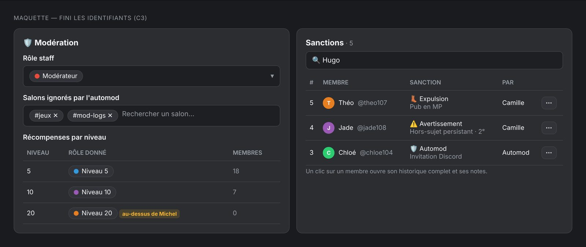
- **Effort.** M. **Risk.** Low. **Data.** None.

### C4 🚀 Live, Discord-style preview

- **Problem.** Admins write templates blind (`<#1200…>`, `{mention}`). The DM test is useful but takes a round trip.
- **For.** Admins.
- **Sketch.** Next to every template (welcome and leave, level-up, birthday, YouTube, RSS embed mode, Embed manager, role menus, custom commands), a live preview that looks like a Discord message: Markdown subset, mentions resolved to names, embed frame, buttons. Inline warnings (unknown variable, `@everyone`) reuse the checks of `template_tests.py`. The rendering stays single-source: a `POST …/preview` endpoint returns the text produced by the production renderer (`fill_message`), and the SPA only draws it.

  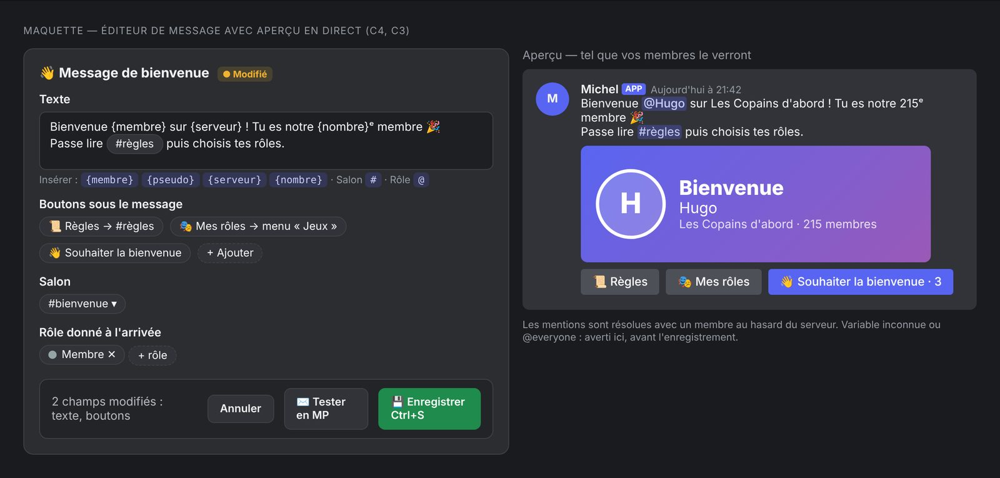
- **Effort.** L. **Risk.** Low–medium: render fidelity, and the preview must escape everything. **Data.** None.

### C5 A sticky save bar, and history with restore

- **Problem.** The save button scrolls away, there's no Ctrl+S, and a bad save can't be undone: the audit log says who changed a module, not what it was before.
- **For.** Admins.
- **Sketch.** When the form is dirty, a bottom bar appears: "3 champs modifiés", Annuler, Tester, Enregistrer (Ctrl+S). Each save stores the module's previous version (secret fields excluded) in `global.config_history` with a 90-day TTL. A "Historique" drawer shows per-field diffs with a "Restaurer" button that goes through the normal save path. The bar is visible in the C4 mockup.
- **Effort.** M. **Risk.** Low.
- **Data.** Config snapshots. Not member data, though they contain admin-written templates and role or channel IDs. TTL 90 days, mentioned in `Privacy.md`.

### C6 🚀 A member space ("Mon espace")

- **Problem.** Any Discord account can log in, and a member lands on a dead end. Meanwhile members have data and settings that only slash commands reach: reminders, birthday, Tricount balances, a Secret Santa list, their data export.
- **For.** Members.
- **Sketch.** For each server shared with Michel:
  - a card (level, rank, season, badges);
  - reminders (create, edit, delete);
  - birthday (set, hide the year);
  - Tricount balances with "J'ai remboursé";
  - the Secret Santa wish list;
  - "Mes données" (the `/mes-donnees` export and delete).

  Everything is scoped to the session's user ID, on guilds where a **live** membership check passes (like `require_guild_admin`, one tier lower).

  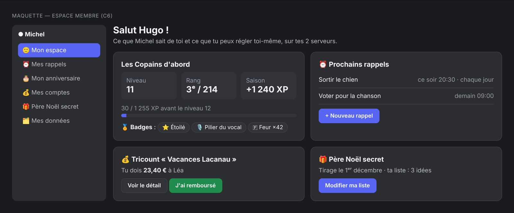
- **Effort.** XL. **Risk.** Medium–high: a new authorisation tier ("member of guild"). Every route must be written so that it can't return someone else's data, with a test per route. **Data.** None new: it's a UI over existing data.

### C7 Accessibility and polish

- **Problem.** The measured issues listed under [Dashboard](#dashboard).
- **For.** Everyone.
- **Sketch.**
  - Contrast: darker green and red buttons, a lighter accent for links, a styled link class.
  - Native `confirm()` replaced by the app's modal (it already traps focus and closes on Échap).
  - Markdown rendered in field help.
  - Phone: the ✕ button of RSS rows; a sticky section index on long pages.
  - The empty "Paramètres" card hidden on the role-menu page.
  - Human names on the health card.
  - A login page that says what Michel is.
  - Extensions listed by label and description, not file name.
  - "Nettoyer la config" moved behind a secondary button.
- **Effort.** S–M. **Risk.** Low. **Data.** None.

### C8 Restructure the front end

- **Facts.** `app.js` is 313 KB and 5 959 lines in one scope, in about 30 sections (schema forms alone take ~850 lines, Spotify stats ~460). It makes **208 manual `escapeHtml()` calls**: each one forgotten is stored XSS on a developer's session, and the CSP stops injected script but not injected markup. It also has 184 inline `style=` attributes. `index.html` is 90 KB, mostly CSS.
- **Option A, stay build-free (recommended).** Split into native ES modules: `static/js/core/{api,state,router}.js`, `ui/{modal,toast}.js`, one file per form widget, one per page, `features/{xp,spotify,rolemenus}.js`. `index.html` loads `<script type="module" src="/static/js/main.js">`, and the CSS moves to `static/app.css`. Add an `` html`…` `` tagged template that **escapes every interpolation by default** (with `raw()` to opt out), so the safe path is the default one, and each module registers its own actions. `test_spa_csp.py` would then scan the directory. Cache-busting: the server hashes the files at startup and serves `?v=<hash>`.
  - Pros: no toolchain, no new dependency, the CSP stays `'self'`, files are debuggable as served.
  - Cons: no types, no minification (gzip covers most of it), more requests (fine over HTTP/2).
- **Option B, a build step** (esbuild or Vite, TypeScript, maybe Preact).
  - Pros: types, components, auto-escaping JSX, tree-shaking.
  - Cons: Node in CI and the Docker build, new dependencies with their lockfile, Dependabot ecosystem and supply-chain surface, built assets to manage, and every contributor needs Node.
- **Recommendation.** Option A now. It delivers most of the benefit (structure and safe-by-default HTML) with nothing new to install. Do it first as a mechanical move with no behaviour change (smoke tests and screenshots as proof), then migrate page by page to `` html`…` ``. Revisit option B only if C4 and C6 push the SPA past ~10 k lines.
- **Effort.** L. **Risk.** Medium: a large diff, made safer by doing it before C4 and C6 and by the browser smoke tests. **Data.** None.

### C9 "Tester" buttons everywhere

- **Problem.** Testing a feed or a connection means leaving the dashboard (`/rss test` exists only in Discord) or waiting for the next poll.
- **For.** Admins.
- **Sketch.**
  - RSS: "Tester ce flux" shows the last 3 entries as they'd be posted.
  - Satisfactory, Minecraft, LLDAP, Uptime: "Vérifier la connexion".
  - YouTube: "Aperçu de la dernière vidéo".
  - Twitch: "Envoyer une notification de test" to a channel you pick.
- **Effort.** M. **Risk.** Low: URLs go through `fetch_untrusted()` as today. **Data.** None.

### C10 Server incidents

- **Problem.** A member who hits an error is told "donne cette référence à un admin : `ab12cd`", but only developers can read logs.
- **For.** Admins.
- **Sketch.** An "Incidents" card on the server page lists this guild's last 50 failed interactions and tasks: reference, command, when, and a short French reason (no traceback). It's searchable by reference. Log records already carry `guild_id` and `correlation_id`; a bounded per-guild buffer keeps them.
- **Effort.** M. **Risk.** Low–medium: nothing sensitive may reach guild admins (no exception text, as today for members). **Data.** Member IDs in memory only, bounded, gone at restart.

---

## D. Quality findings

### D1 Confirmed bugs

Each one is confirmed by a test that fails today (kept outside the repo for now; it becomes the first commit of the fix lot) or by a browser assertion.

| # | Bug | Where | Severity | Confirmed by |
|---|---|---|---|---|
| Q1 | An anti-spam threshold of **1 or less** makes automod delete **every** non-staff message, and record a case and DM the author each time. `int(x or 5)` only replaces 0, and the dashboard accepts any value. | `extensions/moderation/automod.py:78`, schema `moduleModeration.spamThreshold` | **High** (destructive, one typo) | `_track_spam(msg, {"spamThreshold": -3 / 1})` flags the first message |
| Q2 | **14 numeric module fields have no bounds**: starboard threshold, RSS poll minutes, poll durations, anti-spam window, AI vote duration and history… The dashboard saved `threshold = -3` with a success toast. Most are clamped at use, Q1 isn't. | `src/webui/schemas` users | Medium | `validation_errors(…, {"threshold": -3})` is empty, plus the screenshot |
| Q3 | A new role menu's first row is pre-filled with the text **`undefined`** (emoji and label): it starts as `entries: [{}]`, and `escapeHtml(undefined)` returns `"undefined"`. | `src/webui/static/app.js` (`openRoleMenuBuilder`) | Medium | Playwright: both inputs read `undefined` |
| Q4 | `/delete`, `/send` and every `/rolemenu` subcommand declare `ADMINISTRATOR \| MANAGE_MESSAGES` (or `MANAGE_ROLES`), which Discord and interactions.py read as **both**: moderators can't see them and `/aide` hides them. | `extensions/admin/__init__.py:142,207`, `extensions/reactionroles/commands.py:96,168,205,251` | Medium | `_member_can_use(moderator)(ADMIN \| MANAGE_MESSAGES)` is `False` |
| Q5 | `/reminder`: the description is "Gère les rappels pour voter" (copied from `/rappelvote`), the confirmation reads "Rappel **daily** créé…", and "aujoud'hui" is misspelt. | `extensions/reminders/__init__.py:109,153,203` | Low | the test reads the reply |
| Q6 | Typos: `/addwithvote` "ajoouter", `/zevent_finish` "Créée l'embed". | `extensions/spotify/votes.py:568`, `extensions/zevent/commands.py:23` | Low | the test reads the descriptions |
| Q7 | Feur: the rule meant to answer "quoi ?" in mid-message can never match, because sentences are split on `?` before it looks for one. | `extensions/feur.py:61-75` | Low | `_should_respond("quoi ? t'es sérieux", "quoi")` is `False` |
| Q8 | The Spotify extension **fails to import** without a `misc` section, although the schema defaults `dataFolder` to `"data"`: it reads `global_config()["misc"]["dataFolder"]` at import. | `extensions/spotify/_common.py:157` | Low | `KeyError: 'misc'` |
| Q9 | `/rank @x` for a member with no XP **pings x** (a public reply with a bare mention). | `extensions/xp/commands.py:97` | Low | the reply has `<@8>` and no `allowed_mentions` |
| Q10 | `birthdayGuildLocale` defaults to `en_US`, so `/anniversaire liste` shows "March 5" on French servers. | `extensions/birthday.py` schema | Low | from the code |

No security issue turned up beyond Q1 and Q3: config export is masked, the fake-bot session boundaries held, and the error texts shown to members stay generic.

### D2 Bounds on every number, and a guard

- **Problem.** Q1 and Q2.
- **Sketch.** Add `ge` and `le` to the 14 fields. The SPA reads them into `min` and `max` on the input. A registry test, like the `role_use` one, fails on any `int` or `float` field of a module or section without bounds. The use-time clamps stay as defence.
- **Effort.** S. **Risk.** Low. Configs saved out of range show up in `check_config.py`'s warnings, with the list given in the PR.

### D3 Tests for the untested modules

- **Coverage today:** compareai `voting` 18 %, `__init__` 28 %, `mentions` 30 %, `ask` 42 %; `feur` 28 %; olympics `medals` 9 %; streamlabs 45 %; speedons 63 %.
- **Plan:**
  - compareai: handler tests with `discord_fakes` and a fake `AiClient`, covering the vote buttons, closing, the results embed, the mention guardrails (no `@everyone`, cooldown, reply chain) and the quota refusals.
  - feur: a table of the `_should_respond` rules (fixes Q7).
  - streamlabs and speedons: parse fixtures and the embed builders.
  - olympics: delete it rather than test it (D7).
  - Then raise the floors.
- **Effort.** M. **Risk.** Low.

### D4 mypy: the last 64 modules

- **State.** With the skip list removed, the 64 modules report **635 errors**: 393 `attr-defined` (mixins using `self.bot`, `self.repository` and sibling helpers declared nowhere), 104 `arg-type`, 71 `union-attr` (mostly `ctx.guild` being `Optional`), 21 `assignment`. The heaviest are `zevent.tasks` (46), `spotify.votes` (39), `twitch.eventsub` (33), `twitch.schedule` (31) and `moderation.commands` (28).
- **Hidden bugs?** I read the non-mechanical errors and found none: they're typing artefacts (autocomplete decorators, `Timestamp` vs `datetime`, loose annotations).
- **Plan.** One `_base.py` per package declaring what its mixins use, as `extensions/starboard/listeners.py` already does, and a `guild_of(ctx) -> Guild` helper next to `guild_id_of`. Two or three packages per PR, no logic change, delete the lines.
- **Effort.** M–L, spread out. **Risk.** Low.

### D5 A much shorter CLAUDE.md

- **State.** 60 KB, 208 lines, read in full every session: Architecture 35 KB, Notes 20 KB, commands 5 KB. Thirteen guard tests already enforce many of its rules and explain them in their failure messages.
- **Proposal.** CLAUDE.md at **≤ 12 KB**:
  - the commands (unchanged);
  - the three-layer picture;
  - about 40 one-line rules, each ending with "enforced by `tests/test_x.py`" or "details: `docs/conventions/<topic>.md`".

  The reasoning moves to `docs/conventions/{dashboard-security,config,discord-messages,async-io,data-and-retention,extension-lifecycle}.md`, read when a task touches the topic, and into the guard messages. Rule of thumb: a rule a test enforces needs one line; a rule no test enforces either gets a test or keeps its paragraph. Example:

  ```
  - Edit Discord messages through edit_message_if_changed() — tests/test_message_edit.py
  - Background work goes through spawn(), never bare create_task — see docs/conventions/async-io.md
  - No URL literals in code; config fields instead — tests/test_no_hardcoded_urls.py
  ```
- **Effort.** S–M. **Risk.** Low–medium: nothing may be lost. A review checklist maps every current paragraph to its new home.

### D6 Conventions that have drifted

- **Channel lookups.** CLAUDE.md says a channel chosen by a guild's admins is resolved with `fetch_guild_channel()`, yet **25 calls** use `bot.fetch_channel()` on configured IDs (suggestions, mod-log, RSS, YouTube, Twitch, starboard, MDI, VLR, ZUnivers, Confrérie…). They're safe today because the save route checks channel IDs. Either add a source-scan guard and migrate, or reword the rule ("the save check is the boundary; `fetch_guild_channel()` is for IDs read from MongoDB or typed in commands").
- **`/poll` user install.** It declares `integration_types=[…USER_INSTALL]` on a guild-scoped command, which Discord ignores, so the in-memory "user install" fallback in `_record_reaction_poll` is dead code (B4 removes it).
- **Colours outside the palette** ("the palette is the source of truth"): see B8.
- **Option names in English:** see B6.

### D7 Dated modules: archive or delete

- **Problem.** Olympics (Milan-Cortina ended 22 February 2026) and Speedons (2025 API slug) still load and appear as switches on every server page, and still weigh on coverage (`medals.py` 9 %).
- **Options.** Delete them (a single deployment, and git keeps the history), or add `__archived__ = True` to their schemas so they're hidden unless already enabled, under an "Archivés" filter (C2). Zevent already resolves its edition, so it stays.
- **Effort.** S. **Risk.** Low. Your call.

### D8 A dashboard demo mode

- **Problem.** Phase 3 asks for before/after screenshots of every UI change, but the dashboard needs a running bot to show anything real (with no bot, only developers see anything and every picker is empty).
- **Sketch.** Turn the harness used for this review into a dev-only script (`tools/dashboard_demo.py`, outside the image allowlist):
  - a fake bot: 2 guilds, channels by category, coloured roles, 30 members, stubs of the loaded extensions with their tasks;
  - a seeded MongoDB: 60 days of XP, infractions, audit, bot-message slots, task health;
  - three sessions (developer, guild admin, plain member);
  - a `--shots` flag that captures every page at desktop and phone widths.

  It also enables more SPA smoke tests on realistic pages.
- **Effort.** S–M. **Risk.** Low. **Data.** None (test databases only).

---

## Lots

Numbered **P1…P12** so they don't clash with the audit's lots 1–6. Each lot is one branch and one PR, built under the Phase 3 rules (tests first for fixes, French text, `/aide` entries, schemas plus `config.example.json`, privacy coverage, before/after screenshots).

| Lot | Contents | Effort | Why this grouping |
|---|---|---|---|
| **P1 Correctifs** | D1 (Q1–Q10), D2, the small D6 items | S–M | Safety first; the failing tests already exist |
| **P2 Noël** | A6 (+ the B2 modal for the wish list) | M | Calendar-bound: to be merged by about November 28 |
| **P3 Dashboard sans identifiants** | C3, C7, D8 | M | One theme ("make the dashboard legible"); D8 produces the screenshots every later UI lot needs |
| **P4 Clic droit & signalements** | B1, A7, B9 | M | Shared plumbing (context menus, mod-log cards) |
| **P5 Michel vivant** | A1, A2, A4 | L | All three read the same cross-module aggregates |
| **P6 Une voix, une identité** | B8, B6, B7, B10 | M–L | Touches every module's text once; do it before P7 to avoid editing twice |
| **P7 Formulaires & sélecteurs** | B2, B3, B4, B5 | L | Command-flow rework, module by module |
| **P8 Premiers pas** | C1, C2, D7 | L | The new-server experience end to end |
| **P9 Front-end & aperçus** | C8 first, then C4, C5, C9 | L–XL | C8 makes C4 and C5 cheaper and safer; split into two PRs if needed |
| **P10 Espace membre** | C6 | XL | New authorisation tier, its own review |
| **P11 Communauté+** | A8, A9, A10 | M | Small independent wins |
| **P12 Fondations** | D3, D4, D5 | M, ongoing | Can run alongside any lot |
| *Backlog* | A3, A5, A11, B11, C10 | — | Good ideas that build on P5, P6 or P9 |

**Suggested order:** P1 → P2 (date-bound) → P3 → P4 → P5, with P12 trickling alongside. Choose P6 or P8 next depending on whether members (P6) or new admins (P8) matter more to you right now.
